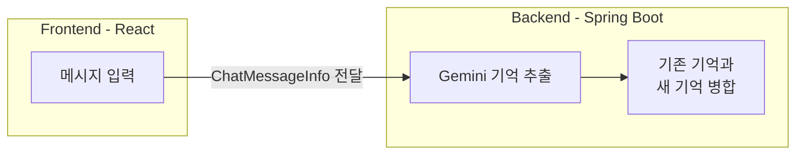
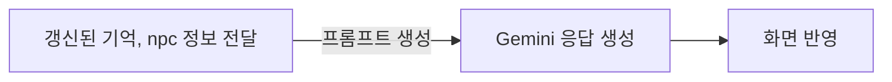

# HSK Web


**중국어 회화 연습을 위한 AI 기반 웹 서비스**

사용자가 다양한 장소와 NPC를 선택하여 중국어로 대화하고, 퀘스트를 수행하며 회화를 연습할 수 있는 서비스입니다.

React와 Spring Boot를 기반으로 구현했으며, AI 응답 생성뿐 아니라 대화 문맥 관리, 퀘스트 진행 상태 추적, API 사용량 제한 기능을 개발했습니다.

## 기술 스택

| 구분 | 기술 |
|---|---|
| Frontend | React, TypeScript,  Tailwind CSS |
| Backend | Java, Spring Boot |
| AI | Google Gemini API |
| Database | MySQL |

## 주요 기능

### 1. NPC 기반 중국어 회화

- 장소 및 NPC 선택
- 자유 대화 / 퀘스트 대화 모드
- 중국어 대화 및 한국어 번역 표시
- 대화 문맥 유지를 위한 장기, 단기 기억 관리

### 2. 퀘스트 기반 회화 진행

사용자가 NPC와 대화하면서 특정 정보를 수집하는 방식으로 퀘스트를 수행합니다.
퀘스트는 requiredFact (필요 정보) 를 가지고 있습니다

1. 퀘스트 id 로 해당 퀘스트에 필요한 정보 확인
2. 해당 정보에 해당 하는 내용이 사용자의 말에 있는 지 확인 (ai 추출)
3. 모든 정보를 수집했다면 -> COMPLETE
4. 아니라면 수집하지 못한 정보를 ai 에게 수집하라고 전달


```
아래 내용은 로그 기록입니다

추출 대상 키: [drink, temperature, paymentMethod]
추출된 facts: {temperature=뜨거운 아이스, paymentMethod=카드, drink=아메리카노}
퀘스트 ID: coffee_order
퀘스트 상태: COMPLETED
퀘스트 수집 정보: {temperature=뜨거운 아이스, paymentMethod=카드, drink=아메리카노}
다음 수집 대상: null
```

### 3. AI 응답 및 대화 문맥 관리

Spring Boot에서 Gemini API를 호출하고, 응답을 가공하여 프론트엔드에 전달합니다.


**구현 시 고려한 사항**

- NPC별 역할과 장소에 맞는 응답 생성
- SessionMemory와 PlayerMemory를 활용한 문맥 관리
- AI 응답에 포함된 불필요한 Markdown 코드 블록 처리
- JSON 파싱 오류를 줄이기 위한 응답 전처리

### 4. 익명 사용자별 API 사용량 제한

로그인 없이 이용할 수 있는 서비스 특성을 고려하여 익명 사용자 식별 기능을 구현했습니다.

**구현 내용**

- UUID 기반 `anonymousId` 쿠키 발급
- UUID 유효성 검증
- 익명 사용자별 일일 API 사용 횟수 관리
- 서비스 전체 일일 API 사용량 제한
- 한국 시간(`Asia/Seoul`) 기준 일일 사용량 관리
- Spring Scheduler를 이용한 오래된 사용량 기록 정리

**설계 의도**

IP 주소로 사용자를 구분할 경우 동일 네트워크의 여러 사용자가 하나의 사용자로 인식될 수 있습니다.

이를 개선하기 위해 UUID 쿠키 기반 식별 방식으로 변경하여, 사용자별 사용량을 관리하도록 구현했습니다.

## 프로젝트 구조

### 구현 구조

## 1. 기억 추출 및 저장


**ChatMessageInfo 는 메세지, npc, 단기/장기 기억을 담고 전달된다**

## 2. 기억 활용 대답


### Backend

| 구성 요소 | 역할 |
|---|---|
| ChatController | 채팅 REST API 요청 처리 |
| ChatService | AI 호출 및 대화 처리 흐름 관리 |
| GeminiService | Gemini API 통신 |
| NpcPromptBuilder | NPC 및 대화 상황별 프롬프트 생성 |
| NpcDataProvider | NPC 정보 제공 |
| QuestDataProvider | 퀘스트 정의 제공 |
| AnonymousUserService | 익명 사용자 UUID 발급 및 검증 |
| UsageLimitService | 일일 API 사용량 제한 관리 |

### Frontend

| 구성 요소 | 역할 |
|---|---|
| Guide | 서비스 이용 안내 |
| Chat | 회화 화면 |
| PlaceNpcSelector | 장소 및 NPC 선택 |
| QuestList | 퀘스트 목록 및 진행률 |
| ChatMessageList | 채팅 메시지 출력 |
| ChatInput | 메시지 입력 |
| useChatSelection | 장소, NPC 및 대화 모드 관리 |
| useChatSession | 대화 내역 및 메모리 관리 |
| useQuestProgress | 퀘스트 진행 상태 관리 |


## 향후 개선 사항

- 실제 사용자 환경에서의 예외 처리 및 안정성 검증
- 배포 환경 구성 및 운영 테스트
- AI 응답 형식 검증 강화
- API 사용량 제한의 동시 요청 처리 검증

